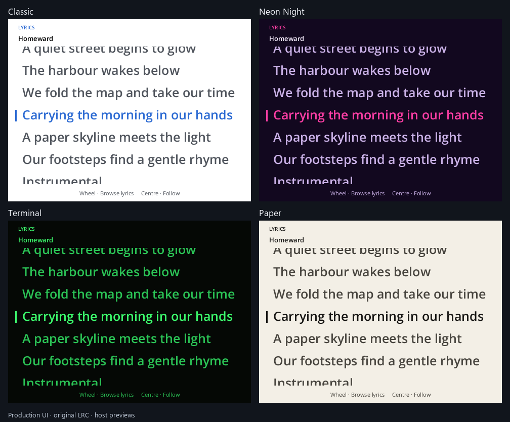
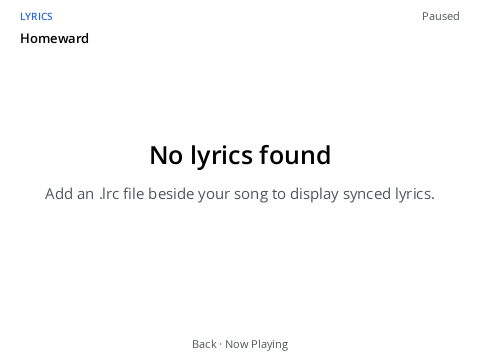

# Synchronized lyrics — host validation

This draft source candidate was validated on 2026-11-11 against Y2Reborn
`0537b06` and unchanged Y2Linux `45765da5088b3641421df74e7d1578fd33931f3f`.
No physical Innioasis Y2 was used. These results do not qualify device memory,
frame pacing, suspend latency or Bluetooth position accuracy.

## Environment and results

The checks ran in a native WHPX Linux VM with four virtual CPUs and 4 GiB RAM,
using a Debian userspace, Rust 1.99, SQLite 3.46.1 and FFmpeg 9
(`libavcodec` 63.1.102). This is a host development environment, not the
production Buildroot image.

| Check | Actual result |
| --- | --- |
| `cargo fmt --all -- --check` | Passed |
| `cargo clippy --workspace --all-targets --locked --offline -- -D warnings` | Passed, no warnings |
| `cargo test --workspace --locked --offline --no-fail-fast` | 811 passed, 0 failed, 10 existing ignored tests; 32 unit/doc target summaries |
| Focused lyrics tests | 7 core parser/lookup, 5 UI and 5 application/worker tests passed; included in the workspace total |
| Production UI previews | Four skin previews and the missing-file view generated and visually reviewed |
| Platform record compatibility | No fields lost or retyped against `e0a57350850c` |
| Reborn platform contract | 483 cases generated; `reborn_reads_the_platform` passed |
| Platform gate | Official byte-baseline mode passed; 1,058 cases identical to clean upstream output on this host |
| Documentation checker | Y2Reborn: 73 pages, 498 local links, no problems; unchanged Y2Linux: 192 existing broken-link problems |

The workspace tests used `RUST_TEST_THREADS=1` to avoid contending real audio
test fixtures. Earlier attempts exposed an existing artwork readiness race:
the test slept for 300 ms before expecting an asynchronous reply. It now waits
for that actual reply with a bounded timeout, retaining the unread-channel,
deduplication and cache assertions. Production artwork code is unchanged.
Menu expectations were updated for the new Lyrics row. Early implementation
compile/test failures were corrected before the final complete run above.

## Platform gate scope

The baseline was recorded once from the unchanged Y2Linux upstream commit:

```sh
sh tools/development/platform-gate.sh --baseline /root/lyrics/platform-baseline
sh tools/development/platform-gate.sh /root/lyrics/platform-baseline
```

This is the script's documented byte-for-byte mode. It runs formatting,
Clippy, the platform ARMv7 type check, the quality ratchet across both trees,
platform Rust tests and comparison of all captured stdout/files against that
clean reference. The ratchet passed without raising any limit or exception.
Record compatibility and the Reborn contract were run separately because
this mode does not invoke them. No Y2Linux source or tracked golden was
changed. A single harness CPU setting bounded its automatic worker pool.

The default semantic golden suite is not claimed as passing. Byte-baseline
mode was used to compare unchanged platform behavior on one consistent host,
avoiding unrelated historical host-library fixture differences. The raw
capture tool deliberately bypasses its semantic shape expectations, as the
official gate script documents; its assertions are not reported as passing
Python unit tests. The actual byte comparison and final `GATE OK` are the
qualification evidence. Both contribution commits were preceded by this gate.

## Preview evidence

These images use the production native renderer and shipped Classic, Neon,
Terminal and Paper palettes, with the original demonstration LRC fixture.
They are host previews at the Y2's 480×360 logical resolution, not device photos.
All seventeen skin files and the compiler's unknown-variable rejection remain
unchanged. The UI tests also exercise the native fallback with a custom light
palette and reduced motion.





## Coverage and remaining qualification

Automated tests cover timestamp precision, stable ties and repeated tags,
sorting, metadata/offsets, invalid arithmetic, BOM/CRLF/Unicode, empty lines,
resource bounds and binary-search lookup. UI tests exercise pause/seek,
navigation, global playback routing, manual browsing, stale-track rejection,
wrapping and reduced motion. Real temporary-file tests cover discovery,
missing/invalid/oversized sidecars, cache/source replacement, worker
cancellation and quiescence. Normal playback does not start the lyrics worker.

Before marking the PR ready, test on a physical Y2: long and short songs,
pause/resume, forward/backward seeks, track transitions under shuffle/repeat,
Bluetooth playback, SD removal/replacement, repeated sleep/wake, long wrapped
Unicode lines and the readability of the active installed skins. Measure
memory, scrolling frame pacing and sleep preparation with a worst-case sidecar.
Enhanced word timing, embedded lyrics, translation selection and remote lyric
providers are outside this change. Reopen Lyrics to reread an edited sidecar.

See the [usage and format guide](../lyrics.md) for controls, exact parsing
limits and reproduction commands.

## Upstream integration, 2026-11-14

Merged upstream `be78d4abe5c44f98a842fbe2e2bc3fad458ce3a5` into the contribution.
The conflict resolution preserves the new core exports and Videos route,
video-control activation and native video rendering alongside Lyrics. Upstream
button mapping and its early command routing remain intact.

The combined tree passed formatting, locked/offline all-target Clippy with
`-D warnings`, and the full locked/offline workspace: **855 passed, 0 failed,
11 existing ignored tests**. This includes the lyrics, video and button tests.
The same native Linux VM and toolchain described above were used. Byte hashes
confirmed 2,467 Rust source/root dependency files matched the contribution tree.

The official platform gate again printed `GATE OK` in byte-baseline mode:
1,058 cases matched clean Y2Linux `61b65d47` on the same host. Separate checks
reported no lost/retyped record fields against `d26d82b876b8` and passed all
483 Reborn platform contract cases. The shared ratchet passed with five
improvements and no raised limits. The default semantic golden suite is still
outside the passing-results claim.

The initial integration check found four upstream Clippy errors. Behavior-
preserving cleanups remove an identity string conversion, pass the QR button's
already-computed selection as one argument, and initialize two test fields in
their struct literals. One full test attempt also hit the existing audio S32
test's asynchronous temporary-directory cleanup race (`DirectoryNotEmpty`);
its isolated rerun and the complete workspace rerun passed without an audio
source change.

The current documentation checker reports two existing Reborn catalog
omissions (the upstream Wi-Fi Share and Button Mapper guides) and 193 problems
in unchanged Y2Linux documentation. The lyrics guide/report links remain valid.
Physical Y2 qualification remains outstanding as described above.
